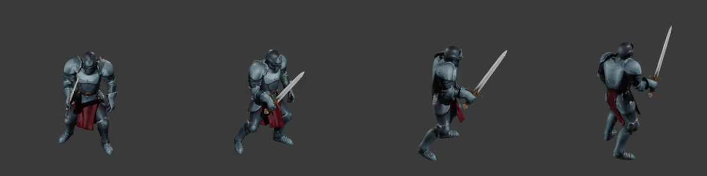
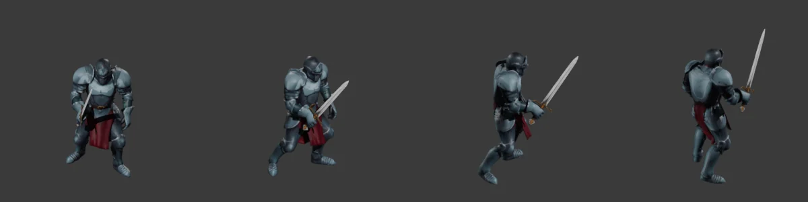

# Knight: one-handed sword attack and idle

A knight with a one-handed sword, taken from a generated 3D model to an attack (56 frames) and an idle loop (101 frames)
at 24 fps, rendered from 8 directions. This is the version that passed review.

## Files

| Path | What it is |
|---|---|
| `sprites/attack_<dir>.webp` | attack atlas per direction: 56 frames of 300 x 300 px, 8 columns, row by row |
| `sprites/idle_<dir>.webp` | idle atlas per direction: 101 frames of 300 x 300 px, 11 columns |
| `preview_attack.webp`, `preview_idle.webp` | animated previews, directions S, SE, E, NE |
| [`attack.json`](attack.json) | the attack's motion file: text phases, key poses and the recipes that solve the sword arm |
| `knight_attack_idle.glb` (release asset of v0.2.0, not in git) | knight and sword, one rig, actions `attack` and `idle`, 2048 px textures, 3.9 MB |

Directions are `S, SW, W, NW, N, NE, E, SE`, where S looks at the character's front. Camera: orthographic, 30 degrees
down, the same for every direction. Frames are opaque on a dark grey background (not cut out).

## How it was made

1. **Model.** The knight is a generated mesh (Meshy) with a repainted helmet. The sword started as the author's concept
   image, turned into a mesh with TRELLIS.2, then cleaned and decimated from 447k to 30k triangles.
2. **Rig.** `auto_rig.py` built the tool's own `amts` skeleton from the mesh, with 5 fingers per hand. Knees and wrists
   under the plate armour were found from the silhouette, without hand-placed joints.
3. **Body motion.** Kimodo generated each action from text (the phases below), constrained through key poses the author
   set by hand in Blender. Legs and hips come from Kimodo.
4. **Arms and head.** Taken from the key poses (`pose_upper_body.py`), head kept on the facing direction (`head_forward.py`).
5. **Sword arm.** `swing_arm` solves the right arm under the blade's path with the settings in [`attack.json`](attack.json),
   then `one_hand_weapon` puts the sword in the fist. Run on the clip from step 4, that file gives the released right arm
   to 0.0003 degrees and 0.0001 cm on all 56 frames, and the same audit. Idle and attack share the first frame, so they
   loop into each other without a jump (left hand 1.2 cm, sword 1.9 cm and 1.3 degrees).
6. **Render.** Blender EEVEE, 300 px per frame, 8 directions; the frames packed into the atlases above (packing is not
   part of the tool).

## The strike, in the recipe's settings

The author's rule for any held weapon: the wrist stays in line with the forearm. The attack meets it through options of
`swing_arm` (all off by default; `pipeline/recipes/swing_arm.py` documents each):

- `pin_toward`: the strike (frame 19) re-posed by hand, forearm lower, elbow 119 -> 137 degrees. The
  path is pulled 3/4 of the way toward that pose's sword: elbow 138 on frame 19, the arm still solved, not pinned.
- `reach`: where the wrist still bent, the grip point moves by one offset per span: 6 cm up on frames 20-22, 12 cm down
  on 24-28, the sword kept 9 cm off the arm and 12 cm off the helmet. `rolls` are the weapon rolls of an earlier run.
- `wrist_anatomical`, `wrist_twist_cap`, `forearm_clear`: on frames 14-30 the wrist is costed as flexion and deviation
  instead of one cone, its twist is capped at 68 degrees, and on 22-30 the sword is kept 9 cm off the forearm.
- `path_edits`, `pin`, `ease_frames`, `path_hold`, `other_arm_blend`: the wind-up grip 20 cm toward the head, and the
  loop join with the idle under the final sword hold.

## Set by hand

- **Key poses**, the strike frame among them, and the **sword hand's fingers** on the first frame: posed by the author
  in Blender, the step the tool's pose scene (`pose_edit_scene.py`) is built for. The fist is read in with
  `one_hand_weapon.py --read-scene`.
- **The idle's left wrist** was straightened by a small script (bend 32-48 -> 15-22 degrees). Nothing else in the idle changed.

## What the audit flagged

`motion_audit.py` gates every clip. On the released one it flags the following; the author reviewed each and accepted it:

- attack: `hand_jump` 22.5 degrees (limit 8) and `elbow_jump` 6.5 cm (limit 3.2) on frames 15-28, the cut itself;
  `pelvis_shake` 4.9 degrees (limit 4) on frames 15-16, from the body's motion; `wrist_flexion_R` 60.7 degrees (limit 50)
  on frame 25; `wrist_twist_R` 67.6 degrees (limit 60) around frame 20.
- idle: the sword hand bends sideways, `wrist_deviation_R` 41.5 degrees (limit 25) on frames 30-97.

The wrist gates came from this clip: on the strike frame a fist hung 73 degrees sideways under a level forearm and the
old single-cone check passed it. The released attack passes the sideways gate.

## Text prompts

Attack (2.35 s):

1. A person stands in a fighting stance with the left foot forward, then raises the right arm high above the right
   shoulder and holds it there for a moment, weight shifting onto the back leg. (0.6 s)
2. The person swings the right arm hard down and across the body to the left, the front knee bending as the hips and
   shoulders turn to the left into the cut. (0.25 s)
3. The person lets the right arm carry on low past the left hip, then sweeps it up across the front of the body and back
   over the right shoulder, the weight returning to the back leg. (0.45 s)
4. The person lowers the right arm and settles back into the fighting stance, the right hand in front of the body, and
   holds the guard. (1.05 s)

Idle (4.2 s):

1. A person stands in a fighting stance with the left foot forward, holding a sword upright in front of the body, and
   takes a deep breath, the chest and shoulders rising, the weight shifting onto the back leg as the head turns to look
   to the left. (1.4 s)
2. The person breathes out, the chest sinking, the weight moving forward onto the front leg as the head turns to look to
   the right, the sword tip swaying slightly. (1.4 s)
3. The person settles back into the same fighting stance, looking ahead, the sword held upright in front of the body. (1.4 s)

## Credits and license

The sprites, previews and the release GLB are published under the repository's license, for use as an example.
The sword mesh comes from TRELLIS.2 (MIT). Built with DINOv3.
